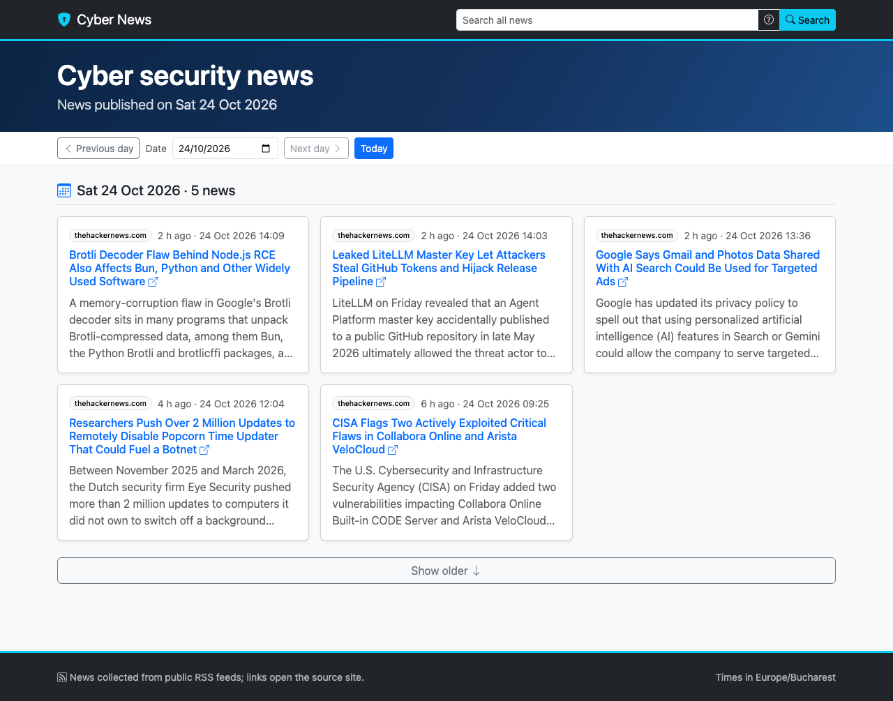

# Cyber News

A Flask web app that displays cyber security news stored in an **existing, remote Elasticsearch** index, in a
Bootstrap 5 UI. This branch (`remote-elasticsearch`) contains the app only: no tests, no RSS ingestion and no
local Elasticsearch. Something else fills the index; the app only reads it.



More screenshots: [another date](docs/screenshots/date.png), [search](docs/screenshots/search.png),
[load more](docs/screenshots/load-more.png), [show older](docs/screenshots/show-older.png),
[mobile](docs/screenshots/mobile.png), [a day without news](docs/screenshots/empty.png).

## Architecture

```
 your server / laptop                                       remote server
 ┌──────────────────────────────────────────────┐          ┌───────────────────────────┐
 │ web app (Flask + Jinja, gunicorn), Docker     │  HTTPS   │ Elasticsearch 9.x          │
 │  web/     routes, templates, static           │ ───────► │  index ES_INDEX            │
 │  service  day / search / show-older rules     │  :9200   │  fields NEWS_FIELD_*       │
 │  store/   NewsRepository port                 │  or :443 │  (filled by another tool)  │
 │           └─ Elasticsearch adapter (PIT)      │          └───────────────────────────┘
 └──────────────────────┬───────────────────────┘
          browser ◄─────┘  127.0.0.1:8000   /  /news  /news/older  /healthz  /readyz
```

- The app is **read-only** over the index. Everything it needs comes from environment variables
  (`cyber_news.config.Settings.from_env`), so the same image runs against any cluster.
- `/healthz` always answers 200 `{"status":"ok"}` (liveness, used by the image's `HEALTHCHECK`). `/readyz`
  answers 200 `{"status":"ready"}` when Elasticsearch answers a ping, else 503 `{"status":"unavailable"}`.
- Building the app never contacts Elasticsearch; invalid settings stop it at start-up with one message per
  problem.

## What the remote cluster must provide

- **Elasticsearch 9.x** (client `elasticsearch~=9.5`, tested against 9.5.5). 8.x clusters are not supported.
- **Network access** from the machine that runs the app to the cluster's HTTP port: usually `9200`, or `443`
  for hosted services such as Elastic Cloud. Open it in the server's firewall or security group for the app
  host only.
- **An index, alias or pattern** (`ES_INDEX`) whose documents have four fields. Their names are configurable
  (`NEWS_FIELD_*`, dotted paths for nested fields):

  | Field (default name) | Mapping type | Used for |
  |---|---|---|
  | `title` | `text` | card title, search (3× boost) |
  | `description` | `text` | card body, search |
  | `link` | `keyword` | the "read more" link, opened in a new tab |
  | `published` | `date` (any format) | "today", the day view and sorting |

  For example:

  ```json
  PUT cyber-news
  { "mappings": { "properties": {
      "title":       { "type": "text" },
      "description": { "type": "text" },
      "link":        { "type": "keyword" },
      "published":   { "type": "date" } } } }

  POST cyber-news/_doc
  { "title": "LiteLLM compromised in supply chain attack",
    "description": "Malicious releases delivered a credential stealer.",
    "link": "https://news.example/litellm",
    "published": "2026-10-24T09:30:00Z" }
  ```

  With `NEWS_FIELD_PUBLISHED=meta.published_at`, the date is read from `{"meta": {"published_at": …}}`.
- **The cluster setting `search.allow_expensive_queries: true`** (the default). Plain-word search finds terms
  of 3+ characters inside words (`llm` matches "LiteLLM") with leading-wildcard queries, which this setting
  allows.
- **A user or API key with these privileges**: `read` and `view_index_metadata` on the index (search and
  point-in-time paging), plus the cluster privilege `monitor` for the `/readyz` ping (`GET /`). A user without
  `monitor` gets working pages but a 503 from `/readyz`; on 9.5.5 an API key's ping was answered without it.

## Connect to the remote server, step by step

Requires Docker with Compose v2 (Docker Desktop, or Docker Engine 23+ with the compose plugin) on the machine
that runs the app, and `curl` for the checks.

### 1. Create read-only credentials on the cluster

Run these as an administrator (Kibana Dev Tools, or `curl` with an admin account). Replace `cyber-news` with
your index name or pattern.

```json
PUT _security/role/cyber_news_reader
{ "cluster": ["monitor"],
  "indices": [{ "names": ["cyber-news"], "privileges": ["read", "view_index_metadata"] }] }

POST _security/api_key
{ "name": "cyber-news-app",
  "role_descriptors": { "cyber_news_reader": {
      "cluster": ["monitor"],
      "indices": [{ "names": ["cyber-news"], "privileges": ["read", "view_index_metadata"] }] } } }
```

The second response contains `"encoded": "…"`; that value is the API key. Store it now; Elasticsearch does not
show it again.

To use basic auth instead, create a user with the role:
`POST _security/user/cyber-news-reader { "password": "…", "roles": ["cyber_news_reader"] }`.

### 2. Save the connection material in the repository directory

Both directories are git-ignored and never reach the image (`.dockerignore` is an allow-list).

```sh
mkdir -p secrets certs
printf '%s' 'PASTE_THE_ENCODED_API_KEY' > secrets/es_api_key   # or the user's password in secrets/es_password
chmod 644 secrets/es_api_key       # the container user (uid 10001) must be able to read the mounted file
```

**CA certificate.** If the cluster's certificate is signed by a private or self-signed CA (the default for a
self-managed Elasticsearch, which generates `config/certs/http_ca.crt`), copy that CA certificate to
`certs/ca.crt`:

```sh
scp admin@es.example.com:/etc/elasticsearch/certs/http_ca.crt certs/ca.crt              # package install
docker cp <es-container>:/usr/share/elasticsearch/config/certs/http_ca.crt certs/ca.crt  # Docker install
```

Skip this when the certificate is signed by a public CA (Elastic Cloud, Let's Encrypt, …), and comment out
`ES_CA_CERTS` in step 4.

### 3. Check the connection from the app's machine

Do this before starting the app. It proves the network path, the certificate and the key in one go.

```sh
ES=https://es.example.com:9200
curl -sS --cacert certs/ca.crt -H "Authorization: ApiKey $(cat secrets/es_api_key)" "$ES/"                 # cluster name and "number": "9.x"
curl -sS --cacert certs/ca.crt -H "Authorization: ApiKey $(cat secrets/es_api_key)" "$ES/cyber-news/_count" # {"count": N, …}
```

Leave out `--cacert certs/ca.crt` for a publicly trusted certificate; with basic auth use
`-u cyber-news-reader:"$(cat secrets/es_password)"` instead of the header. The hostname in `ES` must be one the
certificate was issued for (an IP address only works if the certificate lists it).

### 4. Configure the app

```sh
cp .env.example .env
```

Edit `.env`. At least set `ES_HOSTS` and `ES_INDEX`, and the `NEWS_FIELD_*` names if the index uses other
field names. A typical result:

```sh
ES_HOSTS=https://es.example.com:9200
ES_API_KEY_FILE=/run/secrets/es_api_key
ES_CA_CERTS=/certs/ca.crt
ES_INDEX=cyber-news
APP_TIMEZONE=Europe/Bucharest
```

The paths are the ones **inside the container**; step 5 mounts the files there. Write one `VAR=value` per line
without quotes or inline comments, and comment out a variable rather than leaving it empty.

### 5. Mount the secret and the certificate

Create `docker-compose.override.yml` (git-ignored; `docker compose` merges it automatically):

```yaml
services:
  app:
    volumes:
      - ./secrets/es_api_key:/run/secrets/es_api_key:ro
      - ./certs/ca.crt:/certs/ca.crt:ro
```

Drop the lines you don't need (for example the certificate with a public CA), or mount
`./secrets/es_password:/run/secrets/es_password:ro` for basic auth.

### 6. Start and verify

```sh
make up      # docker compose up -d --build --wait: builds the image, starts the app, waits for /healthz
make check   # GET /healthz and /readyz; fails unless the app reaches Elasticsearch
open http://localhost:8000
```

Other targets: `make logs` follows the app log, and `make down` stops and removes the container. After changing
`.env` or the override file, run `make up` again.

The port is bound to `127.0.0.1` only. To serve other machines, put a reverse proxy with TLS in front of it,
or change the `ports` entry in `docker-compose.yml`.

## Other ways to run

**`docker run`, without Compose:**

```sh
docker build -t cyber-news .
docker run -d --name cyber-news --restart unless-stopped -p 127.0.0.1:8000:8000 --env-file .env \
  -v "$PWD/secrets/es_api_key:/run/secrets/es_api_key:ro" -v "$PWD/certs/ca.crt:/certs/ca.crt:ro" \
  cyber-news
curl -sS localhost:8000/readyz   # {"status":"ready"}
```

**Without Docker** (Python 3.13). Point the `*_FILE` and `ES_CA_CERTS` paths in `.env` at the files on the
host first, for example `ES_API_KEY_FILE=./secrets/es_api_key` and `ES_CA_CERTS=./certs/ca.crt`.

```sh
python3.13 -m venv .venv && .venv/bin/pip install .
set -a && . ./.env && set +a
.venv/bin/gunicorn -w 2 -b 127.0.0.1:8000 'cyber_news:create_app()'
```

## Notes for common setups

- **Elastic Cloud / hosted:** use the deployment's Elasticsearch endpoint URL from its console, with its port
  (`ES_HOSTS=https://<deployment>.es.<region>.<provider>.elastic-cloud.com:443`). The certificate is public,
  so leave out `ES_CA_CERTS`. Create the API key in Kibana (Stack Management › API keys) with the role
  descriptor from step 1.
- **Several nodes:** list them all, comma-separated: `ES_HOSTS=https://es1.example.com:9200,https://es2.example.com:9200`.
- **Cluster on the same machine as the app:** inside the container `localhost` is the container itself; use
  `ES_HOSTS=https://host.docker.internal:9200` (Docker Desktop; on Linux add
  `extra_hosts: ["host.docker.internal:host-gateway"]` to the override file). The certificate must cover the
  hostname you use.
- **Only reachable over SSH:** open a tunnel on the app's machine (`ssh -N -L 9200:localhost:9200 admin@es.example.com`)
  and use the same-machine setup above. The certificate must then cover `localhost`, which Elasticsearch's
  auto-generated certificate does.
- **TLS verification:** keep `ES_VERIFY_CERTS=true` and provide `ES_CA_CERTS`. `ES_VERIFY_CERTS=false` works but
  logs a warning and exposes the connection to interception.
- **Secrets:** prefer the `*_FILE` variables (Docker or Kubernetes secrets) to `ES_API_KEY`/`ES_PASSWORD` in
  `.env`; never put credentials in `ES_HOSTS` (the app rejects that) or bake them into the image.

## Configuration reference

All variables are optional except `ES_HOSTS` in practice; `.env.example` lists them with comments. Variables
that have a default reject a blank value, so leave unused ones unset rather than empty.

| Variable | Default | Notes |
|---|---|---|
| `ES_HOSTS` | `http://localhost:9200` | comma-separated `http(s)://host[:port]`, no credentials in the URL |
| `ES_USERNAME` / `ES_PASSWORD` | — | basic auth, both or neither |
| `ES_PASSWORD_FILE` | — | read the password from a file (Docker secret) instead of `ES_PASSWORD` |
| `ES_API_KEY` / `ES_API_KEY_FILE` | — | API key (encoded form); not combinable with basic auth |
| `ES_VERIFY_CERTS` | `true` | `true/false/1/0/yes/no`; a warning is logged when false |
| `ES_CA_CERTS` | — | path to the CA bundle (https hosts only); must exist where the app runs |
| `ES_REQUEST_TIMEOUT` | `10` | seconds, > 0 |
| `ES_INDEX` | `cyber-news` | index, alias or pattern |
| `NEWS_FIELD_TITLE` | `title` | field names; dotted paths (`meta.published_at`) address nested fields |
| `NEWS_FIELD_DESCRIPTION` | `description` | |
| `NEWS_FIELD_LINK` | `link` | |
| `NEWS_FIELD_PUBLISHED` | `published` | a `date` field |
| `APP_TIMEZONE` | `Europe/Bucharest` | IANA zone that defines "today" and the day boundaries |

## Troubleshooting

Start with `make check`. `/readyz` only says ready or unavailable; for the reason, open http://localhost:8000
and read `make logs`. Each failed page logs `NewsStoreError: Elasticsearch request failed: <status> <type>`
(never the credentials or the request).

| Symptom | Log | Cause and fix |
|---|---|---|
| `make up` fails, the container keeps restarting | `Invalid configuration:` and one `- ES_…:` line per problem | A bad variable: both API key and password set, an `ES_CA_CERTS` or `*_FILE` path that isn't mounted, a blank value, … Fix `.env` / the override file. |
| `/readyz` 503, pages 503 | `ConnectionError` or `ConnectionTimeout` | Wrong host or port, a firewall, or the cluster is down. Repeat step 3 from the same machine. |
| `/readyz` 503, pages 503 | `TlsError` | `ES_CA_CERTS` missing or the wrong CA, or `ES_HOSTS` uses a name or IP the certificate doesn't list. |
| `/readyz` 503, pages 503 | `401 security_exception` | Wrong, revoked or expired API key or password. |
| `/readyz` ready, pages 503 | `403 security_exception` | The key or user lacks `read` / `view_index_metadata` on `ES_INDEX`, or `ES_INDEX` names an index it was not granted (a typo). |
| `/readyz` ready, pages 503 | `404 index_not_found_exception` | `ES_INDEX` doesn't exist (seen with privileges on all indices). |
| `/readyz` 503, pages work | — | A basic-auth user without the cluster privilege `monitor`. |
| Plain-word search 503, operator searches (`"phrase"`) work | `400 search_phase_execution_exception` | `search.allow_expensive_queries` is false on the cluster. |
| Every day is empty but search finds news | — | `NEWS_FIELD_PUBLISHED` is wrong or not a `date` field, or `APP_TIMEZONE` puts the news on other days; try the date input or "Show older". |
| Cards without title, text or link | — | A `NEWS_FIELD_*` name doesn't match the index. |
| Slow pages or timeouts | `ConnectionTimeout` | Raise `ES_REQUEST_TIMEOUT`, or check the latency to the cluster. |

## The Docker image

`python:3.13-slim`, built in two stages from the project wheel. The runtime stage installs from wheels only,
runs as the non-root user `app` (uid 10001), has a `HEALTHCHECK` on `/healthz` and serves
`gunicorn -w 2 -b 0.0.0.0:8000 'cyber_news:create_app()'`. `.dockerignore` sends only `pyproject.toml`,
`README.md` and `src/` to the builder, so `.env`, `secrets/` and `certs/` never reach the image. Building
needs BuildKit (the default since Docker 23). For an x86-64 server from an Apple-silicon Mac:
`docker buildx build --platform linux/amd64 -t cyber-news .`
